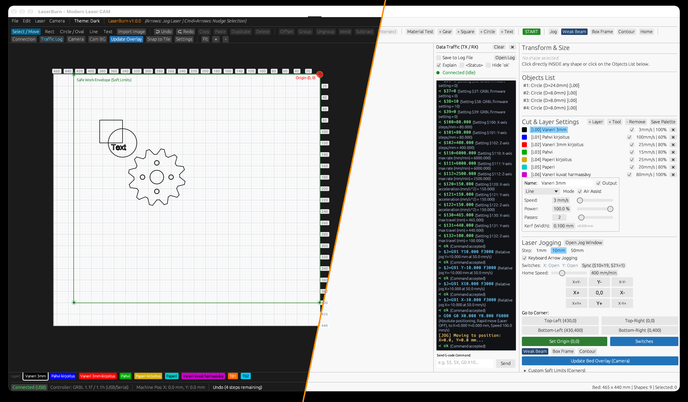

# PhotonCAM 🦀⚡

### The Blazingly Fast, Native Rust Laser Cutting & Engraving CAM for macOS, Windows & Linux

[](LICENSE)
[](https://www.rust-lang.org/)
[]()
[](https://shop.pietiniart.com/l/laserburn)
[](https://buymeacoffee.com/pnp69)

**PhotonCAM** is an open-source, ultra-lightweight, and fully-featured laser CAM & controller application written from scratch in pure **Rust** (`eframe` / `egui`). 

Built as a high-performance native alternative for diode and CO2 laser enthusiasts, PhotonCAM offers direct compatibility with **LightBurn (`.lbrn2` and `.clb`)** files, workshop-tested CAM trajectory optimization, dynamic analog power modulation, and a plain-English serial traffic debugger.

---



---

## ⚡ The Value Proposition: Why PhotonCAM?

Most free laser software out there is either locked to Windows (e.g. LaserGRBL running on legacy .NET), sluggish Electron/Python wrappers consuming hundreds of megabytes of RAM, or simple G-code senders lacking real CAM capabilities.

PhotonCAM was engineered to deliver a responsive, industrial-grade CAM suite that starts instantly and respects your machine's hardware:

| Feature | Legacy Free Tools (e.g., LaserGRBL) | Heavy Commercial Tools | PhotonCAM 🦀 |
|---|---|---|---|
| **OS Support** | Windows only (requires Wine on Mac/Linux) | Windows, Mac, Linux | **100% Native Universal** (macOS Apple Silicon & Intel, Windows 64-bit, Linux) |
| **Startup & Footprint** | Slow cold start, high CPU idle | Proprietary installer, ~400MB+ disk | **<0.2s cold start, <40 MB RAM**, single native binary |
| **LightBurn Compatibility** | ❌ None | Native proprietary | **Direct import/export of `.lbrn2` projects and `.clb` material databases** |
| **Vector CAD & Booleans** | ❌ None (external CAD required) | ✅ Included | **2D Booleans (Weld, Subtract, Intersect) + True SDF Contour Offset** |
| **Beam Kerf Compensation** | ❌ None | ✅ Included | **Auto Inner/Outer Kerf Offset** (+kerf/2 outer, -kerf/2 inner) |
| **Camera Alignment** | ❌ None | Paid add-on camera feature | **4-point Homography ($H$ & $H^{-1}$) + 1-Click Auto-Detect Workpiece** |
| **Controller Diagnostics** | Cryptic error codes (`error:20`) | Basic console | **Live Traffic Log with Plain-English Explanations (`[✓] Explain`)** |
| **License & Privacy** | Windows freeware / closed | Commercial subscription/license | **100% Free & Open Source (GPLv3), 100% Offline & Private** |

---

## 🎯 Key Features

- **⚡ Blazing Fast Rust Performance:** Cold startup in under 200 ms. Real-time 60 FPS pan/zoom viewport even with complex vector graphics and high-density raster rasters.
- **📂 LightBurn `.lbrn2` & `.clb` File Support:** Seamlessly load and save multi-layer LightBurn projects (C00–C29) and import LightBurn material databases into clean per-machine categories (`📁 PhotonCAM Oletus`, `📁 Oma 10W`, etc.).
- **📐 Built-in 2D Vector CAD & Boolean Operations:**
  - **Boolean Tools:** Weld / Union, Subtract ($A - B$), and Intersect overlapping shapes and text.
  - **Interactive Node Editing:** Manipulate vector path vertices directly on the canvas—move nodes, double-click to insert vertices, delete nodes, and toggle open/closed paths (`N`).
  - **Signed Distance Field (SDF) Contour Offsets:** Generate crisp outward sticker cut borders or inward insets with controllable round/miter corner transitions.
  - **Duplication Arrays:** Grid Array (rectangular matrix with gap/pitch) and Radial Array (circular pattern around any center).
  - **Text on Path:** Flow TrueType or single-line Hershey text along circular arcs and curved vector contours.
  - **Automatic Kerf Compensation:** Ensures parts fit together snugly right off the laser honeycomb bed.
- **🖼️ Bitmap to Vector (Image Trace):** Sub-pixel Marching Squares vectorizer with adaptive thresholding, multi-scale smoothing, and collinear curve simplification to convert logos and raster sketches into clean cutlines.
- **📂 Multi-Format CAD & Project Import:**
  - **LightBurn Projects (`.lbrn2`, `.lbrn`):** Direct import and export of cut settings and artwork.
  - **AutoCAD DXF (`.dxf`):** Full 2D CAD support with accurate arc-bulge reconstruction, circles, ellipses, and layer mapping.
  - **Adobe / Vector PDF (`.pdf`):** Extracts vector cutlines from compressed `/FlateDecode` streams with CMYK/RGB color-to-layer mapping.
  - **Scalable Vector Graphics (`.svg`):** Full SVG path parsing.
- **🎨 9 High-Precision Image Dithering Engines:**
  - Atkinson, Floyd-Steinberg, Jarvis-Judice-Ninke, Stucki, Burkes, Sierra3, Ordered Bayer 8x8, Halftone, and Threshold.
- **⚡ True Analog Grayscale Power Modulation (`M4 S...`):** Dynamic continuous spindle PWM power modulation based on pixel luminance, with automatic **Overscan (Lead-in / Lead-out)** to prevent overburnt edges during acceleration.
- **🧱 Ceramic Tile Multi-Layer Paint Simulator:** Real-time visual feedback showing how various laser power levels burn through multi-colored spray paint layers (e.g. Norton TiO2 white tile or Black/Red/Yellow stack).
- **📷 Camera Calibration & 1-Click Workpiece Alignment:**
  - 4-point perspective homography distortion correction with a 2x–8x floating zoom loupe.
  - **1-Click Detect & Center:** Automatically identifies rectangular tiles or wood blanks on the bed and fits selected graphics directly onto them.
- **🚦 Plain-English Serial Traffic Debugger:**
  - Live dual-column TX/RX monitor capturing every G-code command and controller reply.
  - Toggle **`[✓] Explain`** to translate cryptic GRBL alarms (`ALARM:2`), errors (`error:20`), and status packets (`<Idle|WPos:...>`) into plain English.
- **🎯 1-Click Speed × Power Material Test Matrix:** Automatically generates calibration test grids with labeled vector text for rapid speed/power dialing on new materials.
- **🍎 macOS Apple Shortcuts Automation:** Automatically fire custom macOS Shortcuts when a job starts or completes (e.g., turn on air exhaust fan, play notification chime, or alert phone).
- **🌓 Dark & Light Mode:** High-contrast UI themes designed for bright workshop lighting and late-night cutting sessions.

---

## 📥 Downloads

Pre-built binaries are available for every major platform from [GitHub Releases](https://github.com/pietini69/laserburn/releases/latest) or [Gumroad](https://shop.pietiniart.com/l/laserburn):

| Operating System | Package | Architecture | Direct Download |
|---|---|---|---|
| **macOS** (11.0+) | **DMG Installer** | Universal (Apple Silicon M1/M2/M3/M4 + Intel) | [PhotonCAM-1.1.0-universal.dmg](https://github.com/pietini69/laserburn/releases/download/v1.1.0/PhotonCAM-1.1.0-universal.dmg) |
| **macOS** (11.0+) | **ZIP Archive** | Universal 2 | [PhotonCAM-1.1.0-macos-universal.zip](https://github.com/pietini69/laserburn/releases/download/v1.1.0/PhotonCAM-1.1.0-macos-universal.zip) |
| **Windows** (10/11) | **ZIP Executable** | x86_64 (64-bit) | [PhotonCAM-1.1.0-windows-x64.zip](https://github.com/pietini69/laserburn/releases/download/v1.1.0/PhotonCAM-1.1.0-windows-x64.zip) |
| **Linux** | **tar.gz Archive** | x86_64 | [PhotonCAM-1.1.0-linux-x86_64.tar.gz](https://github.com/pietini69/laserburn/releases/download/v1.1.0/PhotonCAM-1.1.0-linux-x86_64.tar.gz) |

> **macOS Note:** On first launch, if macOS Gatekeeper flags the app as unsigned, simply right-click `PhotonCAM.app` in `/Applications` and select **Open**, or run:
> ```bash
> xattr -cr /Applications/PhotonCAM.app
> ```

---

## ☕ Support the Project

PhotonCAM is free and open-source software under the GPLv3 license. If PhotonCAM saves you time, money on commercial licenses, or makes your laser workflow smoother, you can support future development:

☕ **[Buy Me a Coffee (buymeacoffee.com/pnp69)](https://buymeacoffee.com/pnp69)** (Quick tip via Apple Pay, Google Pay, Card or PayPal)

🛒 **[Gumroad Store (shop.pietiniart.com/l/laserburn)](https://shop.pietiniart.com/l/laserburn)**

---

## 🛠️ Building from Source

### Prerequisites
- Install [Rust & Cargo](https://rustup.rs/) (version 1.75+ recommended):
  ```bash
  curl --proto '=https' --tlsv1.2 -sSf https://sh.rustup.rs | sh
  ```

### Build & Run
```bash
# Clone the repository
git clone https://github.com/pietini69/laserburn.git
cd laserburn

# Run unit tests
cargo test --features gui

# Run in release mode
cargo run --release --features gui
```

### Packaging macOS App Bundle & DMG
```bash
# Builds native Universal 2 bundle and DMG under dist/
./scripts/build_dmg.sh universal
```

---

## 🤝 Contributing

Contributions, bug reports, and feature suggestions are warmly welcomed!
- Found a bug or compatibility issue with your laser controller? Open an [Issue](https://github.com/pietini69/laserburn/issues).
- Want to add a feature or improve documentation? Submit a [Pull Request](https://github.com/pietini69/laserburn/pulls).

---

## 📜 License

PhotonCAM is released under the **GNU General Public License v3.0 (GPLv3)**.  
See the [LICENSE](LICENSE) file for details.

Copyright © 2026 Niko Pietinen.
